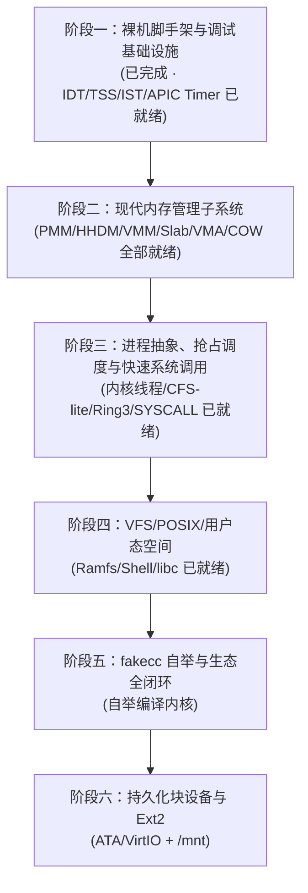

# fakeos

[](https://github.com/esrrhs/fakeos/actions/workflows/ci.yml)
[](LICENSE)

基于自研 C 编译器 [fakecc](https://github.com/esrrhs/fakecc) 从零全新构建的现代原生 64 位操作系统（x86-64）。

---

## 📖 项目愿景与现代化设计准则

`fakeos` 是一套完全基于自主研发的独立 C 编译器 [fakecc](https://github.com/esrrhs/fakecc) 重构的原生现代 64 位操作系统内核（x86-64）。

本项目彻底摒弃传统操作系统几十年来积累的历史兼容包袱（如 16 位实模式、慢速软中断、8259A PIC、C 预处理器文本拼接与宏灾难等），以现代操作系统技术标准从零全新实现。

### 🌟 现代化操作系统核心技术准则

1. **原生 64 位长模式与硬件标准对齐（Native x86-64 Long Mode）**：
   - 彻底告别 16 位实模式与古旧 BIOS 中断，系统从引导阶段立即切入 64 位长模式。
   - 严格遵循 SysV AMD64 ABI 调用规范；引导期全面激活 `CR4.OSFXSR` / `CR4.OSXMMEXCPT` 与 SSE/AVX 向量扩展，保证寄存器保护机制与 ABI 严格契合。

2. **工业级高半核内存布局（Higher-Half Kernel Architecture）**：
   - 内核物理加载在 `0x00100000` (1MB)，虚拟基地址统一映射至负空间 `0xFFFFFFFF80000000` (-2GB 空间)，遵循 `-mcmodel=kernel` 内存规范。
   - 完整的下半部 128TB 巨量虚拟空间全部独立预留给用户空间，实现内核空间与用户态空间的严密物理/虚拟隔离。

3. **现代内存管理与分页模型（Modern Memory Management）**：
   - 全面启用 4 级分页（PML4，并预留 5 级分页 PML5 扩展能力），支持 4KB 标准页与 2MB/1GB 大页。
   - 构建物理内存直接映射区（HHDM: Higher-Half Direct Map），支持无锁/高效物理地址与虚拟地址转换。
   - 物理内存管理采用伙伴系统（Buddy System），内核堆对象分配采用 Slab/Slub 分配器。

4. **现代化异常与中断机制（Modern Exception & APIC Infrastructure）**：
   - 彻底淘汰过时的 8259A PIC 芯片，全面基于 Local APIC 与 I/O APIC 构建现代化中断路由与多核调度基础设施。
   - 基于 64 位中断描述符表（IDT），配置 TSS 与独立的 IST（Interrupt Stack Table）异常中断栈，即便在内核发生栈溢出（Stack Overflow）或双重错误（Double Fault）时也能安全捕获并打印全量寄存器快照 Dump。

5. **高效特权级隔离与原生快速系统调用（Hardware-Native Isolation & Fast Syscalls）**：
   - 彻底废弃慢速过时的 `int 0x80` 软中断陷入机制。
   - 全面采用 x86-64 硬件原生提供的 `SYSCALL` / `SYSRET` 机制，配合 `MSR_LSTAR` 与 `MSR_SFMASK` 实现纳秒级特权级上下文切换。

6. **全栈编译器与内核自洽闭环（fakecc Package Ecosystem）**：
   - 彻底摒弃 C 语言脆弱且容易命名污染的头文件（`#include`）与宏定义（`#define`），以现代类似 Go 的 Package 模块体系驱动内核。
   - 依托 `fakecc` 优秀的 SSA 中端优化与内嵌 ELF 目标生成能力，打通“C 源码 -> 内核机器码 -> 运行测试 -> 自举重编译”全链路。

---

## 🏗️ 整体架构设计

```
+-------------------------------------------------------------------+
|                     User Space (Applications)                     |
|         Shell / Coreutils / Editor / fakecc (自举闭环)            |
+-------------------------------------------------------------------+
|                        fakecc Runtime / libc                      |
|                系统调用封装 / 堆内存管理 / 标准流 I/O                |
+===================================================================+
|                     fakeos Kernel (x86-64)                        |
|  +-------------------------------------------------------------+  |
|  | Fast Syscall Dispatcher (SYSCALL / SYSRET / MSR_LSTAR)      |  |
|  +-------------------------------------------------------------+  |
|  | Process & Preemptive Scheduler (PCB / TCB / Context Switch) |  |
|  +-------------------------------------------------------------+  |
|  | Virtual Memory Manager (PML4 / HHDM / VMA / Demand Paging)  |  |
|  +-------------------------------------------------------------+  |
|  | Memory Allocators (Physical Buddy Allocator / Slab / Slub)  |  |
|  +-------------------------------------------------------------+  |
|  | VFS & File Systems (VFS Core / Ramfs / Ext2)                |  |
|  +-------------------------------------------------------------+  |
|  | Modern Device Drivers (UART 16550 / Framebuffer / VirtIO)   |  |
|  +-------------------------------------------------------------+  |
|  | Architecture Support (64-bit IDT / TSS IST / APIC / HPET)   |  |
+===================================================================+
|                     Hardware / Hypervisor                         |
|                    x86-64 (QEMU / KVM / Baremetal)                |
+-------------------------------------------------------------------+
```

---

## 📅 实施计划与里程碑方案



### 阶段一：裸机脚手架与调试基础设施（Milestone 1 · 已完成）
- [x] **引导方案确定与链接脚本**：实现 Multiboot 1/2 双兼容头，配置高半核链接脚本（LMA `0x100000`, VMA `0xFFFFFFFF80000000`）。
- [x] **fakecc 现代化编译流水线**：建立跨平台（macOS/Linux）构建系统（Makefile），实现包依赖自动解析与无外部头文件独立编译。
- [x] **64 位长模式切换与初始分页**：实现 32 位到 64 位长模式跳转，开启 PAE、Paging 与 SSE 向量支持，搭建初始 4 级页表。
- [x] **基础控制台输出驱动**：实现 UART 16550 串口驱动（COM1 115200 8N1）与 VGA 80x25 文本显存控制台驱动（支持硬件光标与平滑滚屏）。
- [x] **内核格式化日志系统**：实现内核级双通道格式化日志函数 `kprintf`（同步输出至串口终端与屏幕）。
- [x] **自动化测试与 CI 流水线**：编写无头 QEMU 自动化回归测试脚本（`make test`），接入 GitHub Actions 持续集成。
- [x] **64 位 IDT 中断描述符表**：构建 64 位中断门与陷阱门描述符结构，实现统一中断入口派发表（0~47 + 255 spurious，共 49 个门）。
- [x] **CPU 异常捕获与寄存器 Dump**：实现 0~31 号硬件异常（重点覆盖 Page Fault `#PF` 与 General Protection Fault `#GP`）的汇编上下文保存桩（Stubs）与全景寄存器快照 Dump，内核内置 `#DE` / `#UD` / `#PF` 触发-恢复自测。
- [x] **TSS 与 IST 独立异常栈**：初始化 64 位任务状态段（TSS），配置 RSP0 与 IST1 Double Fault 独立守护栈（16 KiB），可防护内核栈溢出。
- [x] **Local APIC 定时器初始化**：启用 IA32_APIC_BASE，建立 LAPIC MMIO 高半核映射，以 PIT 通道 2 校准 APIC Timer 分频，提供稳定的 100 Hz 周期时钟节拍（Tick）。

### 阶段二：现代内存管理子系统（Milestone 2 · PMM/VMM/Slab 已就绪）
- [x] **物理内存管理器（PMM）**：解析 Multiboot 1 提供的内存映射图（mmap，含 ACPI/MMIO 孔洞识别与无 mmap 时的 mem_upper 回退），实现 11 阶伙伴系统（Buddy System，4KiB ~ 4MiB 块），空闲链表按物理地址有序、分裂/合并/双重释放防护完备，提供 `pmm_alloc_page(s)` / `pmm_free_page(s)`；当前管理上限 4 GiB 物理内存。
- [x] **高端物理直接映射（HHDM）**：引导期在 `0xFFFF800000000000`（PML4[256]）建立首个 1 GiB 物理内存的 2MiB 大页直接映射；PMM 首个 buddy 就绪后用 VMM 动态补齐 1 GiB 以上全部 RAM 的 2MiB 映射（页表帧由 buddy 供给），随后撤销临时恒等映射，低半地址空间完整让渡给用户态。实测 2 GiB / 4 GiB 机型正确纳管。
- [x] **虚拟内存管理（VMM）**：实现 4 级页表增删查改工具链（PML4 / PDPT / PD / PT，含 2 MiB 大页），`vmm_map` / `vmm_unmap` / `vmm_translate` 支持属性细粒度控制（NX（开启 EFER.NXE）、Read-Only、User/Supervisor、PWT/PCD 缓存策略），惰性建表、重复映射/冲突大页拒绝、INVLPG 精确失效。
- [x] **内核动态堆分配器（Kmalloc / Slab）**：8 个尺寸类（16B ~ 2048B）单页 Slab 缓存（页首 32B 描述符 + 侵入式空闲链），超大对象直通伙伴系统（8KiB ~ 4MiB 幂整块）；按帧 O(1) 分派表支撑精确 `kmalloc` / `kfree` 与双重释放防护。
- [x] **虚存区间与按需分页（VMA & Demand Paging）**：每进程独立 PML4（内核/HHDM 槽共享、低半空间私有），匿名 VMA 预留 + 首次触页按需分配零页；`#PF` 处理器支持 PROT_READ/WRITE 权限校验、非映射守卫拒绝；实现帧引用计数驱动的**写时复制（COW）fork**——克隆时目录表私有深拷贝、叶子共享置只读并计数，写触发私有拷贝，父空间数据隔离。

### 阶段三：进程抽象、抢占调度与快速系统调用（Milestone 3 · Ring3/SYSCALL 已就绪）
- [x] **执行体抽象（TCB）**：32 槽线程控制块，封装内核栈（buddy 分配 16 KiB）、入口/参数、状态与保存的 RSP；kmain 作为 0 号 idle 上下文。
- [x] **汇编级上下文切换（`switch_to`）**：纯汇编 callee-saved RSP 上下文切换原语 + 新线程跳板；实现协作式 `sched_yield` 与基于 Local APIC tick 的**CFS-lite 加权公平抢占调度（nice/vruntime）**，`kthread_create/exit` 生命周期完整（退出回收栈且不参与轮转）。
- [x] **同步原语**：xchg 测试-设置自旋锁与中断标志 save/restore 原语，切换窗口关中断防止 tick 嵌套切换破坏栈帧；并修复 spurious vector 255 滞留 ISR 会把 APIC PPR 抬到 15 级从而饿死定时器的问题（按 ISR 位条件 EOI，未用 LVT 源全部屏蔽）。
- [x] **调度策略演进（CFS rbtree + task_group SE）**：每 CPU 侵入式红黑树按 vruntime 排序；tick/yield 记账后 requeue；`pick_next` 先选组 SE 树 leftmost 再选组内任务；`nice(2)`（fakeos nr 503；Linux x86-64 无 nice，89 为 readlink）；`task_group` shares + 组 SE 红黑树 + parent/嵌套 child SE（层级 charge/pick；非完整 cgroup）。
- [x] **睡眠锁与原子操作**：自旋锁 + `kmutex`（owner/`trylock`、unlock 只唤醒一个）+ `ksem` 计数信号量（`down`/`up`/`trydown`）+ 类型化 `wait_queue_head`（`sleep`/`wake`/`wake_n`）；自测覆盖争用计数、waiter 进入 `TCB_SLEEPING`、信号量会合、`wake_n(1)` 再 wake-all。
- [x] **用户进程与 PCB**：TCB 扩展 pid/地址空间句柄/用户态标志；每进程独立 PML4 低半空间 + 按需分页用户栈，经 `user_iret_trampoline`（IRETQ 帧）首次进入 Ring 3；切换时联动 CR3、TSS RSP0 与 SYSCALL 内核栈；内嵌极简 ELF64 装载器按 `PT_LOAD` 权限预置 RX/RW 段。
- [x] **原生快速系统调用（`SYSCALL` / `SYSRET`）**：配置 `MSR_STAR`/`MSR_LSTAR`/`MSR_SFMASK`（屏蔽 IF|DF）与 `EFER.SCE`，GDT 布局满足 SYSRET 段选择子推导；`syscall_entry` 在逐线程内核栈上构建 128 字节寄存器帧（用户 RSP 随帧传递，抢占安全），派发 `write/getpid/yield/fork/exit`；`fork` 经 COW 地址空间克隆 + 帧拷贝实现父子双返回；Ring-3 定时器抢占、Ring-3 不可恢复故障单进程猎杀均有自测覆盖。

### 阶段四：VFS、POSIX 系统调用与用户空间（Milestone 4 · 已就绪）
- [x] **虚拟文件系统抽象（VFS）**：`fs` 包提供 inode（常规文件/目录/字符设备）、目录项父子树、打开文件表（offset/refcount）与根挂载；内核态绝对/相对路径解析（多斜杠折叠、`.`/`..`、cwd 规范化）；所有跨包对象以 u32 句柄传递，操作按 inode 类型 if 链分派。
- [x] **内存文件系统（Ramfs）**：静态文件指向 incbin 内核镜像（只读不可变，写打开被拒），运行时文件为 kmalloc/buddy 支撑的动态缓冲（2 倍扩容、1 MiB 上限、稀疏零填充）；目录支持创建与 48 字节定长记录枚举。`/bin/{init,sh,hello,cat,ls}` 与 `/etc/motd` 经多 blob `incbin` 发布，启动时逐级建目录释放到根。
- [x] **每进程文件描述符与 POSIX 文件调用**：TCB 内 16 个 fd 槽，fd 0/1/2 绑定控制台，fork 继承并共享打开文件描述（引用计数），execve 保留，进程退出统一关闭；实现 `read/write/open/close/lseek`，O_RDONLY/WRONLY/RDWR/CREAT/TRUNC/APPEND 与 SEEK_SET/CUR/END；所有用户指针先经 VMA range 校验（字符串按页校验，兼容栈顶 argv）。
- [x] **进程生命周期补齐**：退出记录表 + DEAD 槽延迟到 `wait4` 回收（避免长会话耗尽 TCB 槽），孤儿自动 reparent 到 pid 1；阻塞以内核态 yield 轮询实现，支持 WNOHANG 与 ECHILD 语义，退出码低 8 位经 status 回传。
- [x] **execve 映像替换**：从 Ramfs 文件装载 ELF 到全新地址空间，构造 SysV 初始栈（argc/argv/envp，16B 对齐），改写当前 syscall 帧的用户 RIP/RSP；pid、ppid、fd 表与 cwd 保持不变；坏路径/坏 ELF/超长 argv 返回 -1 且原映像存活。
- [x] **堆与匿名映射**：`brk` 在 ELF 段之上的固定堆区移动 program break（按需分页）；`mmap` 在独立 mmap 窗口分配匿名 MAP_PRIVATE；**匿名 MAP_SHARED**（fork 保写、父子可见，shm 风格）。
- [x] **目录与工作目录系统调用**：`mkdir/chdir/getcwd/getdents64`，每进程 cwd 字符串驱动相对路径解析。
- [x] **串口 TTY 标准输入**：COM1 接收实现 canonical 行规程（256B 行缓冲、字符回显、`\r`/`\n` 兼容、退格编辑、缓冲满强制收行），无输入时 yield 让出；`read(0)` 阻塞至行结束，残余字节留待下次读取。QEMU 串口管道可直接注入命令，Shell 端到端回归无头自动化。
- [x] **PS/2 键盘硬件驱动与按键中断**：IRQ1 set-1 扫描码经 I/O APIC→vector 33，与串口共享 TTY 行规程（见下方 daily-driver 条目）。
- [x] **自研用户态 libc 与 crt0**：单一 `package user` 提供全部 syscall 汇编包装（注意第 4 参 RCX→R10 搬移）、mem/string 例程、mini_printf（%s/%d/%u/%x/%c）、brk bump + first-fit 的 malloc/free；crt0 从初始栈取 argc/argv 调 `main`，返回值即退出码。
- [x] **交互式 /bin/sh 与用户程序**：提示符 `fakeos:~$`（cwd；`~` 缩写 home）、空格分词、内建 `echo`（含 `$?`）/`cd`/`mkdir`/`pwd`/`help`/`exit [code]`；外部命令自动加 `/bin` 前缀，fork+execve+wait4 同步执行并传递退出状态；附带 `/bin/hello`（退出码 42）、`/bin/cat`、`/bin/ls`。启动序列为内核装载 pid 1 = /bin/init（完成阶段三/四全部用户态自测）后 `execve` 到 /bin/sh，`exit` 后内核打印里程碑 SUCCESS。

### 阶段五：fakecc 自举与生态全闭环（Milestone 5 · 已就绪）
- [x] **文件系统与进程环境完备化**：补齐 `munmap`（VMA 拆分/截断与帧归还）、`unlink`、`chmod`、`gettid`、`exit_group`、`futex`（WAIT/WAKE；pthread_mutex 已用）等系统调用；Ramfs 扩容至 256 inode / 64 目录项 / 16 MiB 文件；发布 `/proc/self/environ`（live；空 envp 种子 `FAKECC_PKG=/src`）。
- [x] **编译生成原生 fakecc**：`tools/m5_build_fakecc.sh` 在一次性 /tmp scratch 中把宿主 fakecc 源码交叉编译为静态 Linux x86-64 原生镜像，经 `tools/m5_stage.sh` 暂存为 `/bin/fakecc`（幂等、不修改 fakecc 源码树）。
- [x] **用户空间编译验证**：Shell 支持任意路径执行；OS 内 `/bin/fakecc ping.c -o /tmp/ping && /tmp/ping` 输出 `pong-from-fakeos-compiler`。
- [x] **内核对象逐字节复现**：`/bin/kbuild` 编排器先跑通 编译器→execve 冒烟，再用 OS 内 fakecc 逐个重编 26 个内核 C 模块并与随镜像发布的宿主参考对象（`/ref`）逐字节比对，输出 26 行 `identical` 与汇总 `all 26 kernel objects byte-identical`。
- [x] **OS 内最小静态链接器 `/bin/ldfake`**：解析 ELF64 可重定位对象（节/符号/RELA/字符串表），处理 `R_X86_64_64/PC32/PLT32/GOTPCREL/32/32S`（含合成 GOT 槽与 SHN_ABS 常量），解析跨对象全局符号与链接脚本边界符号（`_kernel_*`），按 `boot/linker.ld` 的低/高两段布局（低段 `0x100000` 恒等映射、高段 `KERNEL_VMA+LMA`）输出**无节头、双 PT_LOAD 的 ELF32 multiboot 镜像**（QEMU 直接引导）；支持 `@response` 文件绕开 execve 8 参数上限，坏输入一律非零退出 + stderr 诊断。
- [x] **重建镜像回传与二次引导**：`/bin/dumpbin` 以长度分帧 base64（`===DUMP/BEGIN ... ===`）把镜像经串口导出，`make test` 解码落盘 `build/fakeos-rebuilt.elf`，校验 ELF32/multiboot/程序头/入口后**用第二个 QEMU 实例引导重建镜像**并跑 hello/pid/exit 7/SUCCESS 精简断言。OS 内 `/bin/ldfake` 与宿主 clang 编译的同份 ldfake 源码对同一输入产出**逐字节一致**；重建镜像低 0x5000 字节引导段与 GNU ld 产物完全相同。
- [x] **重建内核 PMM order-3 / kill 自测**：曾误判为 `ldfake` 高半区 reloc；实为 fakecc tip（`2c1f4525` 之后）O0 对 `imm64 ^ induction` 的 BXOR 误用循环上界寄存器。`test_block_split` 已改为 `block+k` 填充；M5 暂存需钉在良好 fakecc（见 `docs/ldfake-order3-diagnosis.md`）。
- [x] **确定性回归**：`make test` 单条命令覆盖阶段 1-4 全部既有检查点，并串联 编译→比对→链接→导出→二次引导 完整闭环（可连续多次稳定通过）。

### 阶段六：持久化块设备与 Ext2（Milestone 6 · 进行中）
- [x] **PCI 配置空间枚举**：`drivers/pci.c` 通过 0xCF8/0xCFC 扫描 bus 0，按 vendor/device 或 subsystem 定位设备，解码 BAR0，开启 I/O + Bus Master。
- [x] **VirtIO-blk 遗留/过渡驱动（轮询）**：`drivers/virtio_blk.c` 对接 `virtio-blk-pci,disable-modern=on` 的 I/O BAR 遗留寄存器与 4096 对齐 virtqueue。已按设备只读 `QueueNum`（QEMU 10 常为 1024）分配 vring，队列 DMA 读写可用；不再误写只读 QueueNum / 错误钳到 256。
- [x] **ATA PIO 主盘驱动**：`drivers/ata.c` 支持 IDENTIFY / READ / WRITE / FLUSH（28-bit LBA），对接 QEMU `-drive ...,if=ide`。
- [x] **统一块层**：`drivers/blk.c` 先探测 VirtIO（含 1 扇区冒烟），失败则回退 ATA；Ext2 只依赖 `blk_read/write/flush`。
- [x] **最小 Ext2**：`fs/ext2.c` 支持挂载、路径查找、open/read/write/lseek、create、mkdir、getdents、unlink（普通文件）、rmdir、rename、ftruncate、sync；块大小 1024/2048/4096，直接块 + 一/二/三重间接。
- [x] **VFS 集成**：绝对路径 `/mnt...` 分流到 Ext2；进程 cwd 可进入 `/mnt`；退出时正确关闭 Ext2 句柄。
- [x] **宿主工具**：`tools/mkext2.py` 生成最小 Ext2 镜像（≥4MiB 为多 block group）；`make disk` / `make qemu-disk`。
- [x] **自测与持久化冒烟**：启动时写入 `/mnt/m6pass.txt` 并回读；跨两次 QEMU 引导文件仍在；用户态 `/bin/cp`、`/bin/rm` 可把 Ramfs 文件拷到 `/mnt` 并持久化。
- [x] **VirtIO-blk 队列 DMA 排通**：按真实 QueueNum 建环后 used ring 正常前进；`make qemu-disk` 默认 VirtIO，测试仍可用 IDE/ATA。
- [x] **I/O APIC + 中断驱动 UART**：映射 I/O APIC，ISA IRQ4→vector 36；COM1 RDA 中断填环，TTY 阻塞走 `kmutex` + `wait_queue_sleep_unlock`（与 pipe 同型；键盘 IRQ 已接入）。
- [x] **Ext2 rmdir**：空目录删除；`unlink` 不再误拆目录项。Ramfs 同步支持 `rmdir`。
- [x] **Ext2 双间接块**：文件可跨 single-indirect（1K 块下 >268KiB）；trunc/unlink 回收双重间接；自测 `/mnt/big.bin` 270KiB（越过双间接）。
- [x] **Ext2 多块组 + 写入硬化**：按 BGDT 索引多 block group；分配/释放维护 SB/BG 空闲计数；挂载置 `s_state` 脏、`sync` 写回 VALID；journal-lite 恢复标记见下。
- [x] **Ext2 三重间接**：`i_block[14]` 读写/回收；稀疏自测 `/mnt/trip.bin`（越过双间接上限，无需 64MiB 镜像）。`mkext2.py` 默认 4MiB 镜像为 2 个 block group；分配/释放拒绝 SB/BGDT/bitmap/itable，避免多块组相对位图误清 bit0 毁掉元数据。
- [x] **等待队列 / kmutex**：`TCB_SLEEPING` + `sched_sleep`/`sched_wakeup`；`wait4` 阻塞唤醒；内核 `kmutex`。
- [x] **dup2 + shell 重定向**：`>` / `>>` / `<` 对 builtin 与外部命令生效。
- [x] **pipe + shell `|`**：`pipe()`（Linux nr 22）+ 环形缓冲；读写阻塞走 per-pipe `kmutex` + `wait_queue_sleep_unlock`（见下）；shell 支持多段管道（builtin 与外部命令）。
- [x] **VirtIO-net + L2/L3/ICMP**：遗留/过渡 `virtio-net-pci,disable-modern=on`；静态 `10.0.2.15/24`；ARP + IPv4 + ICMP echo 请求/应答；启动自测 ping QEMU user 网关 `10.0.2.2`。
- [x] **用户态 ping**：`sys_ping`（nr 500）+ `/bin/ping`；完整 BSD sockets 仍待做。
- [x] **shell 抛光**：`sync`/`clear` builtin；`/bin/touch` `/bin/mv`；启动进入 `/home`（Ext2 持久工作区，`/home` 与 `/mnt/home` 同卷）。
- [x] **最小套接字 API**：`socket`/`bind`/`connect`/`sendto`/`recvfrom`（UDP）；`/bin/udptest` 环回自测与 `/bin/nc -u`。
- [x] **PS/2 键盘 IRQ1**：i8042 + set-1 扫描码；I/O APIC IRQ1→vector 33；`tty_push_byte` 与串口共享行规程，回显至 UART+VGA。
- [x] **Ext2 persist-root UX**：`/home` 路径别名到 Ext2 卷；Ramfs 保留 `/bin` `/etc` `/tmp` 等；VirtIO-blk 轮询夹带 port I/O，FLUSH 超时最佳努力以免卡死队列。
- [x] **现代 VirtIO-net + MSI/MSI-X RX**：与 blk 共用 cap map；vector 40；`make qemu-modern`。
- [x] **VirtIO-net multi-vector MSI-X TX/RX**：`pci_msix_enable_n`；RX=40/TX=43；TX `io_wait`+`sched_yield`（TCG 安全，同 blk）；modern VERSION_1 hdr=12；`[VNET] [PASS] MSI-X TX/RX split`（`make qemu-modern`）。
- [x] **VirtIO-blk MSI-X/IRQ 完成**：vector 41；used-ring `io_wait`+`sched_yield`（TCG 安全；MSI wakeup 仍保留）。
- [x] **IRQ 驱动 VirtIO-net**：PCI INTx → I/O APIC level → vector 40；`virtio_net_irq` ack ISR 后 `net_poll` 收包；idle 轮询仅作备份。
- [x] **TCP 握手与流**：`listen`/`accept` + 三次握手；已连接 `send`/`recv`（sendto/recvfrom 与 read/write）；环回自测；`/bin/nc` TCP 模式（`nc -l PORT` / `nc HOST PORT`）。SYN/数据经 100Hz 定时器重传。
- [x] **Shell `&&` / `||` / 作业**：命令列表短电路；尾 `&` 后台 + `jobs`/`fg`/`bg`（最多 4 作业，`%n` 选择，WNOHANG 回收提示）。
- [x] **更丰富 VGA 文本**：控制台写回显至 VGA；CSI 解析（清屏/光标/颜色/行擦除），`clear` 对图形窗口生效。
- [x] **简易行编辑器 `/bin/ed`**：`a/c/d/p/n/w/e/q` 子集，可写 Ext2 持久文件。
- [x] **Ext2 default-root UX**：Ramfs 保留 `/` 列表与 `/bin` `/etc` `/tmp` `/proc` `/src` `/ref` `/asm` `/dev`；其余绝对路径（含 `/home`）落入 Ext2 卷（`/mnt` 仍为卷根别名）。
- [x] **Signals + Ctrl-C**：`kill`/`SIGINT`/`SIGKILL`/`SIGTERM`/`SIGCHLD`；TTY Ctrl-C 向 foreground（`tty_setfg`）投递 SIGINT；默认动作终止；shell 在 wait 前设置 fg。
- [x] **DHCP + 更丰富 DNS**：内核 DHCP DISCOVER/REQUEST（QEMU user-net，失败回退 `10.0.2.15/24`）；Makefile `QEMU_NET` 显式 `net=`/`dhcpstart=`；`/etc/resolv.conf` 多 nameserver + search；libc 解析缓存/重试/search 后缀。`127.0.0.1` loopback 仍可用。
- [x] **DHCP 租约续期**：解析 option 51；T1/T2/expiry 挂 100Hz 定时器；BOUND→RENEW（单播）→REBIND（广播）；ACK 重装计时，NAK/过期回退静态。
- [x] **login/getty stub**：`/etc/passwd` + `/bin/login`（root / 空或 root 密码）后 exec `/bin/sh`。
- [x] **TCP retransmit timer**：100Hz 节拍上对未确认 SYN/数据段重传；shell `PATH`（`/bin:.:...`）与引号分词；`kill` builtin。
- [x] **sigaction + 用户态投递帧**：`rt_sigaction`（nr 13）保存 handler/restorer/sa_flags；syscall 返回路径可把用户栈改写成最小 sigframe 并跳入 handler；`rt_sigreturn`（nr 15）+ libc `__sig_restorer`。无 restorer 的自定义 handler 仍按 DFL 终止。
- [x] **SA_RESTART**：`sa_flags` 存入 TCB；`wait4`/TTY 阻塞在自定义 handler 且带 `SA_RESTART` 时不因该信号返回 EINTR（继续睡眠，handler 在 syscall 自然返回时投递）。
- [x] **shell history / `!!` + readline**：环形 32 条；`history`/`!!`；TTY CSI A/B 历史、Left/Right、Home/End、Ctrl-A/E/U/W/K、Ctrl-V quoted Tab。
- [x] **auth crypt stub**：`/etc/passwd` 支持 `$fake$salt$hash`（FNV-1a）；libc `crypt`/`crypt_check`；默认 root 口令 `root`。
- [x] **fakecc M5 tip pin 文档**：`docs/ldfake-order3-diagnosis.md` + Makefile/`m5_stage.sh` 明确要求 restage 钉在 `2c1f4525`。
- [x] **Ext2 journal-lite**：未用 SB 区 magic/gen/flags/mode/jblk 作恢复标记 + control/ring；DESCRIPTOR/REVOKE/COMMIT 多 txn；脏挂载或无 COMMIT 的 `META_PENDING` 时按位图重计空闲；`create`/`write`/`mkdir`/`unlink`/`rmdir`/`trunc`/`rename` 包围 begin/commit；`sync`/`fsync` 清标记并写 `VALID_FS`（仍非完整 jbd）。
- [x] **SIGTSTP / Ctrl-Z 作业停止**：`TCB_STOPPED` + `wait4(WUNTRACED)`；TTY ISIG 在 UART/PS2 输入路径拦截 Ctrl-C/Z（wait4 阻塞时也可投递）；shell `jobs`/`fg`/`bg` 续跑 `SIGCONT`。
- [x] **fsync(2)**：nr 74；Ext2 fd 触发卷级 sync（与 journal-lite 标记配对）。
- [x] **进程组 / 会话**：`setpgid`/`getpgid`/`setsid`/`getsid`；`kill(0/-pgid)` 广播；TTY Ctrl-C/Z 投递到前台 **pgid**；shell 管道共用一组以便整组停止；`wait4(WCONTINUED)`。
- [x] **Demand paging 抛光**：匿名读缺页共享全局 zero 页（只读映射），写时再私有分配/COW；卸载时钉住 zero 页。
- [x] **更丰富套接字**：`shutdown`/`getsockname`/`getpeername`（TCP 半关闭；UDP mute）。
- [x] **AHCI / modern virtio 笔记**：`docs/blk-modern-path.md`；启动时 PCI `01.06` AHCI 探测日志；默认 legacy virtio-blk/ATA。
- [x] **tcsetpgrp / tcgetpgrp + SIGTTOU/SIGTTIN**：自定义 nr 501/502（`u_tcsetpgrp`/`u_tcgetpgrp`）；后台读/写控制台与 `tcsetpgrp` 投递停止信号；shell 用 `tcsetpgrp` 切前台。
- [x] **setsockopt / getsockopt + select**：`SO_REUSEADDR`/`SO_TYPE`/`SO_ERROR`；`select`/`poll`（nfds≤64）。
- [x] **AHCI/modern virtio 探测加深**：`pci_bar(n)`/`pci_bar64`、AHCI ABAR+CAP/VS、virtio modern cap 映射、`pci_msi_enable`。
- [x] **AHCI 单端口 DMA + IRQ**：`drivers/ahci.c`（IDENTIFY / READ·WRITE DMA EXT / FLUSH）；MSI/MSI-X 或 INTx → vector 42 + `sched_sleep`（轮询回退）；`blk` 优先 virtio→AHCI→ATA；`make qemu-ahci`。
- [x] **poll(2) + select channel-sleep**：阻塞时 `sched_sleep` 在 select 通道上；tty/pipe/sock `select_kick` 唤醒；可中断 EINTR。
- [x] **ioctl TTY termios**：nr 16，`TIOCGPGRP`/`TIOCSPGRP`/`TCGETS`/`TCSETS`；真实 ICANON/ECHO/ISIG/ICRNL + `c_cc`；非 ICANON 走 raw 读。
- [x] **shell session-leader / fg**：`setsid` + 本 pgid 前台（不再清成 0）；回收 TTY 走 ioctl/tcsetpgrp。
- [x] **VMA_FILE 按需分页 + MAP_SHARED 写回**：文件 `mmap` 建 `VMA_FILE`，缺页填充；`MAP_SHARED` 跨 fork 保写，脏页在 munmap/进程退出时写回；`make qemu-modern` 试现代 virtio-blk/net + MSI-X。
- [x] **mmap POSIX 加深**：文件 `MAP_FIXED`（选址建 `VMA_FILE`，重叠拒绝）；`mprotect(2)`（nr 10）改 VMA prot 并即时更新叶子 PTE（含 VMA 拆分）；自测 `[U][PASS] file MAP_FIXED mmap` / `mprotect RO/RW`。
- [x] **PROT_NONE + mmap addr hint**：`mmap`/`mprotect` 支持 `PROT_NONE`（保帧清 `PTE_U`，访问 #PF）；非 `MAP_FIXED` 的非零 `addr` 作选址提示（冲突则回退）；`MAP_FIXED` 重叠仍拒绝（无 silent replace）；自测 `[U][PASS] PROT_NONE + mmap addr hint`。
- [x] **CFS rbtree 加权公平调度**：每 CPU 侵入式红黑树（vruntime, tid）；tick/yield 记账后 erase+insert；`pick_next`/steal 走 leftmost；`nice(2)`；自测 nice0 ≥2× nice+10 + 树不变量。
- [x] **匿名 MAP_SHARED**：`mmap(MAP_SHARED|MAP_ANONYMOUS)` 真实帧（不用 zero 页），fork 保写，子写父见。
- [x] **POSIX shm 路径**：`/dev/shm` + `ftruncate(2)` + libc `shm_open`/`shm_unlink`；文件 `MAP_SHARED` 跨 fork 可见；自测 `[U][PASS] POSIX shm_open/mmap/unlink`。
- [x] **/dev 字符设备节点**：`/dev/null`（读 EOF / 写丢弃）、`/dev/zero`（读零 / 写丢弃）、`/dev/tty`（控制台路径别名）；shell `>`/`>>`/`<` 重定向可用；拒绝 unlink；自测 `[U][PASS] /dev/null /dev/zero /dev/tty`。
- [x] **stat/fstat/newfstatat**：Linux x86-64 `struct stat`（144B）；Ramfs/Ext2/pipe/sock；`newfstatat` 支持 `AT_FDCWD`、目录 fd 相对名、`AT_EMPTY_PATH`；`ls -l` 用 fstatat 显示 mode/size；自测 `[U][PASS] stat/fstat/newfstatat`
- [x] **/proc/self/{status,maps,cmdline,environ}**：动态节点（open 时快照）；`status`/`maps`/`cmdline`/`environ`；自测 `[U][PASS] /proc/self status/maps/cmdline`
- [x] **getppid/uname/nanosleep/clock_gettime**：Linux nr 110/63/35/228；utsname 6×65；100 Hz tick 时间（无 RTC 时 REALTIME≈MONOTONIC）；shell `ppid`/`uname`/`sleep`；自测 `[U][PASS] getppid/uname/nanosleep/clock_gettime`
- [x] **symlink/readlink**：Linux nr 88/89；Ramfs+Ext2；`lstat`/`AT_SYMLINK_NOFOLLOW`；shell `ln -s`/`readlink`；`nice` 改 fakeos nr 503；自测 `[U][PASS] symlink/readlink`
- [x] **hard link(2) + shell ln**：Linux nr 86；Ramfs `nlink` + Ext2 `i_links_count`；同 FS；拒绝目录；`oldpath` nofollow；`unlink`/`rename` 按链接计数释放；shell `ln TARGET LINKPATH`（硬链）与 `ln -s`；自测 `[U][PASS] hard link(2)`；virtio login smoke（smp 1/2）。
- [x] **getcwd physical + shell cwd prompt + ls -l ->**：`chdir` 存物理路径（`CWD_LEN=128`）；提示符显示 cwd（`~` 缩写 `/home`）；`realpath` builtin；`ls -l` 对符号链接显示 `name -> target`；自测 `[U][PASS] getcwd physical`
- [x] **shell env/export/unset/which**：shell 环境表（默认 `PATH`/`HOME`/`USER`/`FAKECC_PKG=/src`）；`export`/`unset`/`env`/`which`；`$NAME`/`$?`；`cd` 走 `$HOME`。
- [x] **execve envp + live /proc/self/environ**：内核解析最多 8 个 env 串写入 SysV 栈与 TCB；空 envp 仍种子 `FAKECC_PKG=/src`；shell 把环境表传入子进程。virtio login smoke（smp 1/2）。
- [x] **chmod/umask + Ext2 getdents/`ls` 文件参数**：`chmod(2)` 更新 Ramfs/Ext2 权限位（保留 `S_IFMT`）；每进程 `umask(2)`（默认 0022，fork 继承）作用于 `open(O_CREAT)`/`mkdir`/`symlink`；shell 内建 `chmod MODE FILE...` / `umask [MODE]`；Ext2 `getdents` 对齐 Ramfs 48B 布局（name@19）；`ls -l FILE` 走 `AT_EMPTY_PATH`。virtio login smoke（smp 1/2）。
- [x] **ls -l mtime + getuid/chown stubs**：`struct stat` 填 `st_uid`/`st_gid`/`st_mtime`（boot-relative 秒，同 `clock_gettime(REALTIME)`）；Ramfs inode 与 Ext2 `i_uid`/`i_gid`/`i_mtime` 在 create/write 打戳；`getuid`/`geteuid`/`getgid`/`getegid` + `chown(2)`；shell `id` / `chown UID[:GID] FILE...`；`ls -l` 显示 `mode uid gid size mtime name`。自测 `[U][PASS] getuid/chown/mtime`；virtio login smoke（smp 1/2）。
- [x] **TTY Tab completion**：ICANON 行编辑下 Tab 补全光标处单词；相对路径相对 cwd，绝对路径用目录前缀；命令位（行首、无 `/`）另搜 `/bin` + 内建名表；唯一目录命中追加 `/`；无匹配/无进展响 BEL；ECHO 关闭时跳过。virtio login smoke（smp 1/2）。
- [x] **TTY Double-Tab match listing**：歧义且无公共前缀进展时首次 Tab 响 BEL，再次 Tab 列出候选（目录名尾加 `/`）并回显当前编辑缓冲（内核不知 shell 提示符）。其它编辑清 pending。virtio login smoke（smp 1/2）。
- [x] **TTY Ctrl-W/K + quoted Tab**：ICANON 下行编辑 Ctrl-W 删光标前一词、Ctrl-K 删至行尾；Ctrl-V 引用下一键（Tab 插入字面 `\t`，回显占一格以保持光标 1:1）。virtio login smoke（smp 1/2）。
- [x] **TTY Ctrl-L redraw/clear**：ICANON 下 Ctrl-L 清屏（串口 CSI `2J`/`H` + `vga_clear`）并回显当前编辑缓冲（内核不知 shell 提示符，同 Double-Tab）；ECHO 关闭时只清屏不回显。virtio login smoke（smp 1/2）。
- [x] **/bin/head + /bin/wc**：`head [-n N]|-N` 默认 10 行；`wc [-lwc]` 计行/词/字节（多文件带 total）；stdin/`-` 可用。virtio login smoke（smp 1/2）。
- [x] **shell history 持久化**：环形 32 条写入 `/home/.sh_history`（Ext2）；启动 `hist_load`，每条命令后 `hist_save`+`fsync`；`!!`/`history`/CSI 上下跨重启仍可用。virtio login smoke（smp 1/2）。
- [x] **/bin/getent**：`getent passwd|group|hosts [key...]`；无 key 时 dump；passwd/group 按名或 uid/gid 过滤；hosts 先扫 `/etc/hosts`，否则 `resolve_host`（含 DNS）。virtio login smoke（smp 1/2）。
- [x] **/bin/nc select duplex + shutdown**：TCP/UDP 已连接路径用 `select` 在 stdin↔sock 全双工转发；TCP stdin EOF 时 `shutdown(SHUT_WR)` 半关闭并继续读至对端 FIN；UDP listen 对最近 peer 回程，stdin EOF 退出。virtio login smoke（smp 1/2）。
- [x] **/bin/tail + /bin/grep + /bin/printf**：`tail [-n N]|-N` 默认 10 行（环缓）；`grep [-ivnF]` 定串行过滤（无 BRE）；`printf FORMAT` 支持 `\n/\t/\r` 等转义与 `%s/%d/%u/%x/%c/%%`。virtio login smoke（smp 1/2）。
- [x] **/bin/tee + /bin/basename + /bin/dirname**：`tee [-a] [FILE...]` 把 stdin 同时写到 stdout 与文件（`-a` 追加）；`basename PATH [SUFFIX]` / `dirname PATH` 路径分量。virtio login smoke（smp 1/2）。
- [x] **/bin/true + /bin/false + /bin/seq**：`true`/`false` 退出码 0/1；`seq [-s SEP] LAST|FIRST LAST|FIRST INCREMENT LAST` 整数序列。virtio login smoke（smp 1/2）。
- [x] **/bin/cut + /bin/tr**：`cut -c LIST` / `cut -f LIST [-d DELIM] [-s]` 按字符或字段裁剪；`tr SET1 SET2` / `tr -d SET` 字符转换/删除（支持 `a-z` 与 `\n\t\r`）。virtio login smoke（smp 1/2）。
- [x] **/bin/test + /bin/[**：薄 POSIX `test`/`[`（退出 0/1/2）；一元 `-e/-f/-d/-h/-L/-s/-r/-w/-x/-z/-n` 与 `-b/-c/-p/-S`；二元 `=`/`!=`/`-eq/-ne/-lt/-le/-gt/-ge`；单层 `!`；`[` 要求收尾 `]`。virtio login smoke（smp 1/2）。
- [x] **/bin/uniq + /bin/sort**：`uniq [-c][-d][-u]` 折叠连续重复行；`sort [-r][-n]` 字典序/数值排序（内存载入）。virtio login smoke（smp 1/2）。
- [x] **/bin/yes + /bin/od**：`yes [STRING...]` 重复输出行直到写失败；`od [-A n|o|x|d] [-t x1|o1|c] [-N COUNT] [FILE...]` 薄十六进制/八进制转储（默认 `-A o -t x1`）。virtio login smoke（smp 1/2）。
- [x] **shell echo -n/-e + /bin/xargs**：shell `echo [-neE]`（`-n` 无换行、`-e` 反斜杠转义含 `\c`、`-E` 字面）；`/bin/xargs [-n N] [-r] [CMD [ARGS...]]` 按空白分词拼 argv（默认打印；批量受 execve argc=8 限制）。virtio login smoke（smp 1/2）。
- [x] **/bin/cmp + /bin/dd**：`cmp [-l|-s] FILE1 FILE2` 按字节比较（退出 0/1/2；`-s` 静默、`-l` 列出差异）；`dd [if=] [of=] [bs=N] [count=N] [skip=N] [seek=N] [status=none]` 块拷贝（`k`/`b`/`M` 后缀；默认 bs=512）。virtio login smoke（smp 1/2）。
- [x] **/bin/expr + /bin/hostname**：`expr` 薄整数运算/`length`（`+ - * / %` 与比较；`*` 需 shell 引用）；`hostname` 打印 `uname` nodename。virtio login smoke（smp 1/2）。
- [x] **/bin/echo**：外部 `echo [-neE]`，与 shell 内建对齐（`-n`/`-e`/`-E`/`\c`）；供 `xargs echo` 等路径。virtio login smoke（smp 1/2）。
- [x] **/bin/sleep**：外部 `sleep SECONDS`（非负整数），走 `nanosleep(2)`，与 shell 内建对齐；供 `xargs sleep` / 脚本 exec 路径。virtio login smoke（smp 1/2）。
- [x] **/bin/truncate**：`truncate -s SIZE FILE...`（非负整数 SIZE，可选 `k`/`K`/`b`/`B`/`M` 后缀），走 `open`+`ftruncate(2)`；缺失文件按 0644 创建。virtio login smoke（smp 1/2）。
- [x] **/bin/mkdir + /bin/pwd + /bin/ln**：外部 `mkdir [-p]`、`pwd`、`ln [-s]`，与 shell 内建对齐；供 `xargs` / 脚本 `exec` 路径。virtio login smoke（smp 1/2）。
- [x] **/bin/chmod + /bin/uname + /bin/env + /bin/sync**：外部 `chmod MODE FILE...`、`uname [-a]`、`env`（读 `/proc/self/environ`）、`sync`，与 shell 内建对齐；供 `xargs` / 脚本 `exec` 路径。virtio login smoke（smp 1/2）。
- [x] **/bin/readlink + /bin/realpath + /bin/printenv**：外部 `readlink PATH`、`realpath PATH`（物理解析，与 shell 内建对齐）、`printenv` 为 `/bin/env` 别名；供 `xargs` / 脚本 `exec` 路径。virtio login smoke（smp 1/2）。
- [x] **/bin/date + /bin/stat**：外部 `date [+%s]`（`clock_gettime(REALTIME)` 启动相对秒）、`stat [-L] FILE...`（默认 `lstat`，`-L` 跟 `stat`）；供 `xargs` / 脚本 `exec` 路径。virtio login smoke（smp 1/2）。
- [x] **/bin/nl + /bin/fold**：外部 `nl [-b a|t] [-v N] [-w N] [-s SEP]` 行号、`fold [-w WIDTH] [-s]` 折行；供管道/脚本。virtio login smoke（smp 1/2）。
- [x] **/bin/expand + /bin/unexpand**：外部 `expand [-t N]` 制表符展开、`unexpand [-a] [-t N]` 空格收折；供管道/脚本。virtio login smoke（smp 1/2）。
- [x] **/bin/comm + /bin/join**：外部 `comm [-123] FILE1 FILE2` 三列比较已排序文件、`join [-t C] [-1 N] [-2 N] FILE1 FILE2` 按字段连接；供管道/脚本。virtio login smoke（smp 1/2）。
- [x] **/bin/split + /bin/csplit**：外部 `split [-l N] [-a N] [FILE [PREFIX]]` 按行切分、`csplit [-f PREFIX] [-n DIGITS] FILE LINE...` 按行号切分；供脚本。virtio login smoke（smp 1/2）。
- [x] **/bin/fmt + /bin/which**：外部 `fmt [-w WIDTH]` 段落填行、`which CMD...` PATH 查找（shell-mirror；内建仍覆盖 builtin）；供管道/脚本。virtio login smoke（smp 1/2）。
- [x] **/bin/cksum + /bin/sum**：外部 `cksum` POSIX CRC+长度、`sum [-r|-s]` BSD/SysV 校验和；供管道/脚本。virtio login smoke（smp 1/2）。
- [x] **/bin/strings**：外部 `strings [-a] [-n N]` 提取可打印串（默认长度 4，`-nN` 粘连）；供管道/脚本。virtio login smoke（smp 1/2）。
- [x] **/bin/pr + /bin/column**：外部 `pr [-n][-t][-w N][-l N][-h HDR]` 分页抬头、`column -t [-s SEP]` 表格式对齐；供管道/脚本。virtio login smoke（smp 1/2）。
- [x] **/bin/md5sum + /bin/sha1sum**：外部 `md5sum`/`sha1sum` 真实摘要（RFC 1321 / FIPS 180-1）；供管道/脚本。virtio login smoke（smp 1/2）。
- [x] **/bin/sha256sum**：外部 `sha256sum` 真实 FIPS 180-4 SHA-256 摘要；供管道/脚本。virtio login smoke（smp 1/2）。
- [x] **/bin/base64**：外部 `base64 [-d] [FILE...]` 编码/解码（76 列换行；`-d` 忽略空白）；供管道/脚本。virtio login smoke（smp 1/2）。
- [x] **/bin/factor + /bin/clear + /bin/tty + /bin/whoami**：外部 `factor [NUMBER...]` 质因数、`clear` ANSI 清屏（shell-mirror）、`tty [-s]`（TCGETS→`/dev/tty`）、`whoami`（geteuid+/etc/passwd）；供管道/脚本。virtio login smoke（smp 1/2）。
- [x] **/bin/id + /bin/groups**：外部 `id`（shell-mirror：uid/euid/gid/egid + groups=）与 `groups`（egid + getgroups，经 `/etc/group` 解析名）；供管道/脚本。virtio login smoke（smp 1/2）。
- [x] **/bin/cal**：外部 `cal MONTH YEAR` / `cal YEAR`（周日起始；无 RTC 故不支持无参当前月）；供脚本。virtio login smoke（smp 1/2）。
- [x] **/bin/mktemp + /bin/rev + /bin/paste**：外部 `mktemp [-d][-u] [TEMPLATE]`、`rev [FILE...]`、`paste [-s] [-d LIST] [FILE...]`；供脚本/管道。virtio login smoke（smp 1/2）。
- [x] **shell mkdir -p + /bin/rm -r**：shell `mkdir [-p] DIR...` 递归创建路径分量（已存在目录视为成功）；`/bin/rm [-r|-R] FILE...` 递归删除目录树（getdents 收集后 unlink/rmdir）。virtio login smoke（smp 1/2）。
- [x] **setuid/seteuid + groups**：`setuid`/`setgid`/`setreuid`/`setregid`/`getgroups`/`setgroups`（nr 105/106/113/114/115/116）；TCB 补充组最多 8；文件创建用 euid/egid；`/etc/group` + login 按 passwd uid/gid 与组成员 `setgroups`/`setgid`/`setuid` 后 exec；shell `id` 显示 groups，`setuid`/`seteuid` 内建；自测 `[U][PASS] setuid/seteuid/groups`；virtio login smoke（smp 1/2）。
- [x] **AHCI NCQ-lite**：多槽 CL + 条件 FPDMA（CAP.SNCQ）；块层仍同步/单 bounce；`make qemu-ahci` 可现 `[NCQ]`。
- [x] **AHCI async NCQ**：每槽 bounce（depth 4）+ 单次传输内多 outstanding FPDMA；`ahci_selftest` 写读尾扇区；`make qemu-ahci` 见 `[AHCI] [PASS] async NCQ multi-outstanding`（块层 API 仍同步序列化）。
- [x] **AHCI bio queue（跨调用方）**：共享 bio 队列（8）让多个同步调用方共用 NCQ 窗口；`ahci_selftest` 双 bio 重叠提交；`make qemu-ahci` 见 `[AHCI] [PASS] bio queue cross-caller`。
- [x] **blk_async end_io**：非阻塞 `blk_async_rw`/`ahci_async_rw` + completion callback；IRQ/`blk_async_poll` 收割；`ahci_selftest` 双提交无 wait；`make qemu-ahci` 见 `[AHCI] [PASS] blk_async end_io`。
- [x] **CFS rbtree**：每 CPU `cfs_root` 红黑树替代线性扫描 `pick_next`；enqueue/dequeue 覆盖 sleep/wakeup/stop/cont/exit/steal；自测 `[PASS] CFS rbtree`。
- [x] **CFS task_group SE rbtree（层级公平）**：`task_group` shares（默认 1024）；每 CPU 组 SE 侵入式红黑树（vruntime, tg id）+ nr；enqueue/dequeue 维护组 SE；charge 后 requeue；`pick_next` leftmost 组再选成员；`sched_tg_create/attach`；自测 shares / aggregate / nested mid+leaf shares+aggregate / SE 树不变量；非完整 cgroup。
- [x] **SMP MADT + AP park**：`arch/smp.c` MADT 发现 + `ap_tramp`；默认 `-smp 1` 不拉 AP；`-smp 2` 时 AP long-mode 后停泊，经 `sched_smp_start` 进入 per-CPU idle。
- [x] **futex(2) basics**：`FUTEX_WAIT`/`FUTEX_WAKE`（+PRIVATE）；`sched_wakeup_n`；跨 fork `MAP_SHARED` 自测 `[U][PASS] futex WAIT/WAKE`。
- [x] **AP trampoline bring-up**：`ap_tramp` @ phys `0x8000`，MADT CPU 发现，静态 per-AP 栈；AP 进入 long mode 后停泊至 `sched_smp_start`。`make qemu-smp`（`-smp 2`）。
- [x] **AP into scheduler (idle slice)**：per-CPU `current` + idle TCB + `sched_run_lock`；AP 加载内核 GDT/IDT 后进入调度器 idle（尚不偷任务）。自测日志 `[SMP] AP%u entered scheduler`。
- [x] **AP timer + per-CPU TSS/IST**：共享 GDT 上每 CPU 独立 TSS（RSP0 + IST1）；AP trampoline/`cpu_enable_sse` 打开 OSFXSR；`LTR` 后 `lapic_ap_timer_enable`；ISR XMM 用 `movdqu`（leaf `hlt` 可能仅 8 字节对齐）。`-smp 2` 自测 `[PASS] AP LAPIC timer + per-CPU TSS/IST`。
- [x] **Cross-CPU runqueue steal**：每线程 `rq_cpu`/`on_cpu`；本地 CFS 优先，空闲则从远端 RQ **先偷内核再偷用户**；`MSR_GS_BASE` 指向 per-CPU SYSCALL 导管（`[gs:0]` kstack / `[gs:8]` user RSP）。`-smp 2` 自测 `[PASS] Cross-CPU steal`。
- [x] **Signals polish (SMP delivery)**：用户态 IRQ/IPI 路径经 trap frame 投递自定义 handler；`sched_signal_send` 对远端 `on_cpu` 发 vector-34 kick；sigframe 保存/恢复 RAX；pipe read/write 支持 EINTR 与 SA_RESTART 继续阻塞；自测 `[U][PASS] SIGTERM handler` / `SIGSTOP/CONT` / `pipe read EINTR` / `pipe SA_RESTART`。
- [x] **IPI reschedule + load-aware balance**：`rq_select_cpu` 优先空闲/低负载 RQ；创建路径 `rq_enqueue_balanced`；wakeup 对空闲 home CPU 发 vector-34；ISR 在内核态 idle 上立即 `pick_next`。`-smp 2` 自测 `[PASS] IPI resched balance`。
- [x] **Ext2 journal ordered/writeback durability**：`JL_MODE_ORDERED`（默认）在 `jl_commit` 前 `blk_flush`，保证数据先于清除 `META_PENDING`；`WRITEBACK` 跳过提交刷盘（`fsync`/`sync` 仍排空）；SB 持久化 mode；自测 crash-sim `[EXT2] [PASS] journal ordered durability recover`（大文件自测暂切 WRITEBACK 避免每 KiB FLUSH）。
- [x] **Ext2 journal commit-block**：SB `jblk` 指向一块 OPEN/COMMIT 记录；`jl_commit` 写 `JL_J_COMMIT`（ORDERED 在 COMMIT 前后各 FLUSH）；挂载时若 `META_PENDING` 且 commit 块 gen 匹配则清标记而不 recount；自测 `[EXT2] [PASS] journal commit-block recover`（仍非完整 jbd）。
- [x] **Ext2 journal descriptor/revoke + multi-txn ring**：control 块 + 8-slot 环；`jl_commit` 写 DESCRIPTOR（脏 meta）/REVOKE（释放块）/COMMIT；多 txn 环内共存；挂载扫环匹配 COMMIT；自测 `[EXT2] [PASS] journal descriptor/revoke + multi-txn ring`（仍非完整 jbd）。
- [x] **Ext2 journal metadata-copy replay**：commit 时把脏 meta 整块快照进 4-slot copy pool；`META_PENDING`+匹配 COMMIT 时先 replay 再清标记；自测 `[EXT2] [PASS] journal metadata-copy replay`（仍非完整 jbd）。
- [x] **Ext2 ordered journal × blk_async**：`jl_write_meta_copies`/`jl_replay_meta_copies` 经 `blk_async_write_batch` 管道化（AHCI NCQ 重叠；VirtIO/ATA inline）；**8-slot copy pool** + **revoke-aware replay**（跳过 ring REVOKE 中的 home）；自测 `[EXT2] [PASS] journal ordered blk_async meta-copy` / `journal copy pool grow` / `journal revoke-aware meta-copy replay`（仍非完整 jbd）。
- [x] **Ext2 data-path blk_async**：文件数据整块写走独立 8-slot bounce + `blk_async_write_batch`（`jl_commit`/sync 前排空；`bread` 仅在命中挂起块时排空以免打断批处理）；`blk_async_write_batch` 升至 max 8、按 wave/4 提交以适配 AHCI NCQ；自测 `[EXT2] [PASS] data-path blk_async full-block`。
- [x] **Ext2 ftruncate(2)**：grow（sparse）/shrink（保留前缀并释放尾块）/zero；自测 `[EXT2] [PASS] ftruncate grow/shrink/zero`。
- [x] **Ext2 rename(2)**：同卷目录项移动（文件/目录）；替换已存在普通文件或空目录；跨目录移动目录时更新 `..` 与父链接计数；Ramfs 同步支持；`/bin/mv` 优先 `rename`，跨 FS 仍 copy+unlink；自测 `[EXT2] [PASS] rename same-dir/cross-dir`。
- [x] **pthread_mutex on futex**：libc NPTL-style 0/1/2 word + `atomic_xchg`/`atomic_cmpxchg`；`lock`/`trylock`/`unlock`；跨 fork `MAP_SHARED` 自测 `[U][PASS] pthread_mutex futex lock/unlock`。
- [x] **clone(2) / pthread_create basics**：`CLONE_VM|CLONE_THREAD` 同 AS 新 tid（`gettid`）；AS `refs` retain/release；libc `pthread_create`（mmap 栈 + start trampoline）；自测 `[U][PASS] pthread_create clone same-AS`。
- [x] **pthread_join + FS TLS**：`arch_prctl(ARCH_SET_FS/GET_FS)` + 调度切换恢复 `MSR_FS_BASE`；libc `pthread_join`（futex）/`pthread_self`；自测 `[U][PASS] pthread_join + FS TLS`。
- [x] **pthread_exit / detach / stack reclaim**：`pthread_exit` 经 FS TLS owner 发布 retval；`pthread_detach`；join/detach 延后 `munmap` 栈，由后续 `pthread_create` 回收；自测 `[U][PASS] pthread_exit retval` / `pthread_detach + stack reclaim`。
- [x] **CLONE_CHILD_CLEARTID-style join**：`set_tid_address(2)`（nr 218）登记 per-TCB `clear_child_tid`；线程/进程退出时内核将 `*ctid=0` 并 `futex` 唤醒；libc `pthread_join` 等待该字归零（不再依赖用户态 WAKE）；自测 `[U][PASS] pthread_join CLEARTID`（raw `exit` 路径）。
- [x] **睡眠锁完备化（kmutex/ksem/wait_queue）**：在既有 channel sleep 上补齐 owner/`trylock`、计数信号量与类型化 waitqueue；`sched_selftest` 验证睡眠而非忙等。
- [x] **pipe 走 kmutex + wait_queue**：每 pipe 一把 `kmutex` + 读/写 `wait_queue_head`；`wait_queue_sleep_unlock` 在 run-lock 下原子放锁并睡眠，避免 unlock-then-sleep 丢唤醒；表分配另有 `pipes_table_lock`；自测 `[PASS] pipe kmutex + wait_queue_sleep_unlock blocking`（写端填满环后进入 `TCB_SLEEPING`）。
- [x] **TTY 走 kmutex + wait_queue**：控制台读与 pipe 同型——`tty_lock` + `tty_wait`；空环在 CLI 下检查后 `wait_queue_sleep_unlock`；UART/PS2 摄入路径 `wait_queue_wake`；自测 `[PASS] tty kmutex + wait_queue_sleep_unlock blocking`（waiter 进入 `TCB_SLEEPING`，`tty_push_byte` 唤醒）。
- [x] **socket 走 kmutex + wait_queue**：每 sock 一把 `kmutex` + `wait_queue_head`；`recv`/`accept`/`connect` 阻塞走 `wait_queue_sleep_unlock`（空检查在 CLI 下，与 tty 同）；RX/状态路径（含 ISR `net_poll`）只 `wait_queue_wake` 不取锁；自测 `[PASS] sock kmutex + wait_queue_sleep_unlock blocking`。


> **暂存（scratch）边界说明**：OS 内构建所需的编译器、内核/运行时源码、参考对象与 nasm 对象仅存在于构建期暂存树 `build/m5stage/`（由 `tools/m5_stage.sh` 生成，`.gitignore` 已覆盖整个 `build/`）；它们以只读 incbin 形式编入默认镜像的 m5 blob（`m5blob.o`），在 OS 内发布为 `/bin/fakecc`、`/src/...`、`/ref/...`、`/asm/...`。重建内核时 `/bin/kbuild` 用空的 `m5stub.o` 顶替 m5 blob（二次引导时发布 0 个暂存文件，保留等价用户空间），因此重建镜像体积更小但功能完整。

> **已修复的上游缺陷 · 自举字节一致性**：此前 upstream fakecc 存在一处 use-after-free（`src/sema.c` 中 `ftab_lookup()` 返回表内指针后跨 `realloc` 悬垂），导致「CMake 构建的编译器」与「fakecc 自举出的编译器」对 `kernel/vfstest.c` 的输出有稳定 5 字节差异（寄存器分配读到了已释放的堆内存）。该缺陷已由 [esrrhs/fakecc#92](https://github.com/esrrhs/fakecc/pull/92) 修复：valgrind 报错清零，`stage2_check.sh` 达到不动点，26 个模块**全部逐字节一致**。完整分析、复现命令与修复验证见 [`docs/fakecc-bootstrap-nondeterminism.md`](docs/fakecc-bootstrap-nondeterminism.md)。
>
> 因此第 132 行的严格断言已恢复：字节不一致会**立即失败**。`/bin/kbuild` 保留 `[kbuild] DIFF` 的诊断打印，但不再放行；`scripts/test_qemu.py` 断言 26 个模块**全部 identical、0 个 DIFF**。

---

## 🛠️ 构建与运行

### 依赖环境
- [fakecc](https://github.com/esrrhs/fakecc)（自主研发 C 编译器，建议加入环境变量 `PATH`；另需一份 fakecc 源码树，默认取 `../fakecc`，可用 `FAKECC_SRC=... make` 覆盖）
- `nasm`（汇编器）
- `x86_64-elf-binutils`（或 Linux 系统原生 `ld` / `objcopy`）
- `qemu-system-x86_64`（虚拟机与模拟器）
- `python3`（用于自动化回归测试脚本）

### 常用命令
```bash
make          # 编译 64 位高半核内核二进制镜像 (build/fakeos.elf)
make test     # QEMU 无头回归：阶段 1-4 全部断言 + OS 内自举闭环 + 重建镜像二次引导
make qemu     # 在当前终端中无头 (Headless) 启动 QEMU（串口控制台交互，按 Ctrl-A 然后按 X 退出）
make qemu-gui # 启动带图形窗口的 QEMU（查看 VGA 80x25 文本控制台显示画面）
make clean    # 清理所有构建中间文件与产物（含 m5stage 与 build/fakeos-rebuilt.elf）
```

---

## 📄 开源许可证

本项目采用 [MIT License](LICENSE) 授权许可。
